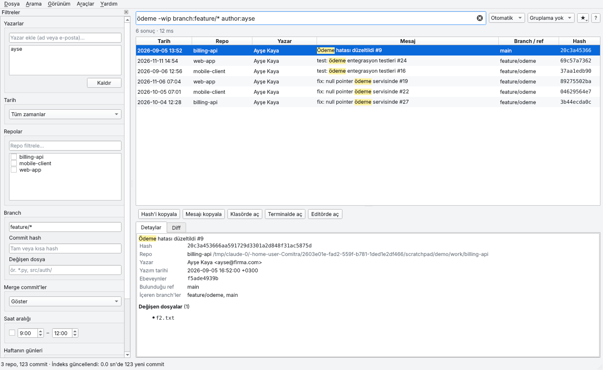
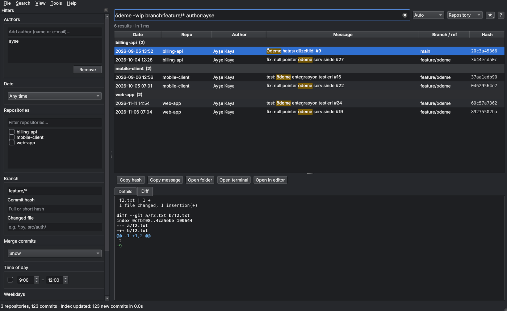

# Comitra

**Bilgisayarınızdaki tüm git repolarında, tüm branch'lerdeki commit'leri tek yerden arayın.**

🌐 **Web sitesi ve indirmeler:** <https://oguzcanozdemir.github.io/Comitra/> · [English](https://oguzcanozdemir.github.io/Comitra/en/)

Comitra; Windows, macOS ve Linux'ta çalışan, tamamen çevrimdışı bir masaüstü
uygulamasıdır. Seçtiğiniz klasörlerdeki git repolarını bulur, commit'leri yerel bir
SQLite veritabanına indeksler ve milisaniyeler içinde arama yapmanızı sağlar.
Verileriniz bilgisayarınızdan dışarı çıkmaz.



## Özellikler

- **Otomatik repo bulma**: normal repolar, submodule'ler, bare repolar. Worktree'ler
  tekilleştirilir, `node_modules` ve `venv` gibi klasörler atlanır.
- **Tüm branch'ler**: yerel ve uzak branch'ler, tag'ler, detached HEAD.
- **Türkçeye uygun tam metin arama**: büyük/küçük harf ve aksan duyarsız (`odeme` yazınca
  `Ödeme` bulunur, `iade` yazınca `İADE` bulunur). Tam ifade, ön ek ve dışlama desteklenir.
- **Filtreler**: yazar (ortak yazarlar dahil), tarih, hazır tarih seçenekleri, repo,
  branch (`feature/*`), hash, değişen dosya, merge commit, saat aralığı, haftanın günü.
- **Arama kutusu ve filtre paneli senkron**: birinde yaptığınız değişiklik diğerine yansır.
- **Sonuçlar**: en yeni / en eski / en alakalı sıralama, eşleşen kelime vurgulama;
  repoya, yazara veya güne göre gruplama; milyonlarca sonuçta bile akıcı sanal kaydırma.
- **Detay paneli**: tam mesaj, iki tarih, ortak yazarlar, commit'i içeren branch'ler,
  değişen dosyalar ve renklendirilmiş diff.
- **Hızlı eylemler**: hash kopyalama; repoyu klasörde, terminalde veya editörde açma.
- **Artımlı güncelleme**: yalnızca değişen repolar taranır. Fetch ile gelen eski tarihli
  commit'ler de yakalanır. Force-push veya rebase sonrası kaybolan commit'ler silinmez,
  işaretlenir.
- **Arka planda güncelleme**: açılışta, belirli aralıklarla veya repolarda değişiklik
  algılandığında.
- **İsteğe bağlı güvenli `git fetch`**: şifre sormaz, zaman aşımı vardır, asla prune yapmaz.
- Kayıtlı ve son aramalar, istatistik ekranı, CSV/JSON dışa aktarma.
- Açık ve koyu tema, Türkçe ve İngilizce arayüz, klavye kısayolları.
- Kurulumlu ve **taşınabilir (portable)** sürümler.
- Arayüzün yaptığı her şey için bir **komut satırı aracı** da vardır.



## Kurulum

Tek gereksinim bilgisayarda **git** kurulu olmasıdır (<https://git-scm.com>).
Hazır paketler [Releases](../../releases) sayfasındadır:

| Platform | Kurulumlu | Taşınabilir |
| --- | --- | --- |
| Windows 10/11 (x64) | `Comitra-…-windows-x64-setup.exe` (yönetici izni gerekmez) | `Comitra-…-windows-x64-portable.zip` |
| macOS 11+ (Apple Silicon / Intel) | `Comitra-…-macos-arm64.dmg` / `…-x64.dmg` | `Comitra-…-macos-…-portable.zip` |
| Linux (x86_64) | `Comitra-…-linux-x86_64.AppImage` | `Comitra-…-linux-x86_64-portable.tar.gz` |

- **Windows:** Kurulum dosyasını çalıştırın. SmartScreen uyarısında *Ek bilgi →
  Yine de çalıştır*'ı seçin (paket imzalı değildir). Taşınabilir sürüm için zip'i açıp
  `Comitra.exe`'yi çalıştırın.
- **macOS:** `.dmg`'yi açıp Comitra'yı *Applications* klasörüne sürükleyin. İlk açılışta
  sağ tık → *Aç* deyin (paket Apple tarafından onaylı değildir). Taşınabilir sürümü
  *İndirilenler* klasörü dışına taşıyıp öyle açın. Masaüstü, Belgeler gibi klasörlere
  erişim izni sorulursa onaylayın.
- **Linux:** AppImage'a çalıştırma izni verin (`chmod +x Comitra-*.AppImage`) ve çalıştırın.
  Taşınabilir arşivi açtıktan sonra isterseniz `./install.sh` ile uygulama menüsüne ekleyebilirsiniz.

### Taşınabilir mod

Taşınabilir paketlerde programın yanında `comitra-portable.txt` dosyası bulunur. Bu dosya
varken ayarlar ve indeks programın yanındaki `comitra-data` klasöründe tutulur. Klasörü USB
belleğe kopyalayıp başka bir bilgisayarda kullanabilirsiniz. Dosyayı silerseniz normal
kullanıcı klasörleri kullanılır:

| | Ayarlar | Veritabanı |
| --- | --- | --- |
| Windows | `%APPDATA%\Comitra` | `%LOCALAPPDATA%\Comitra` |
| macOS | `~/Library/Application Support/Comitra` | aynı |
| Linux | `~/.config/Comitra` | `~/.local/share/Comitra` |

`--portable` parametresi veya `COMITRA_HOME=/bir/klasör` ortam değişkeni de aynı işi yapar.

## Kullanım

1. İlk açılışta **Klasör ekle** ile repolarınızın bulunduğu klasörü seçin (ör. `~/projeler`).
2. Comitra repoları bulur ve indeksler. İlerleme durum çubuğunda görünür.
3. Arama kutusuna yazın veya soldaki filtre panelini kullanın.

### Sorgu sözdizimi

```
ödeme hatası                  tüm kelimeler (aksan/büyük-küçük harf duyarsız)
"ödeme hatası"                tam ifade
login*                        ön ek
-wip  -"work in progress"     dışlama
author:ahmet,ayse@firma.com   yazar veya ortak yazar   (yazar:)
repo:billing                  repo adı/yolu içerir      (proje:)
branch:main branch:feature/*  branch'ten erişilebilen   (dal:)
hash:a1b2c3d                  hash (yalnızca hash yazmak da olur)
file:*.py file:src/auth/      değişen dosya             (dosya:)  – dosya indeksi gerekir
date:today|yesterday|7d|30d|month|year     (tarih:bugün|dün|buay|buyıl)
date:2026-11-10   date:2026-10-01..2026-10-31   date:2026-10
after:2026-10-01 before:2026-11-01         after dahil, before hariç
hour:09-12  hour:22-06        günün saati (yazarın saat diliminde)   (saat:)
day:fri,sat  day:weekend      haftanın günü                          (gün:cuma, gün:haftasonu)
merge:hide|only               merge commit'leri gizle / sadece onlar (merge:gizle|sadece)
unreachable:include|only      hiçbir branch'te olmayan commit'ler
sort:newest|oldest|relevance  sıralama                               (sırala:yeni|eski|alaka)
```

Örnek: `author:ahmet repo:billing branch:feature/* after:2026-10-01 before:2026-11-01 ödeme -wip`

Aynı filtrede birden çok değer **VEYA**, farklı filtreler **VE** ile birleşir.

### Klavye kısayolları

| Kısayol | İşlem |
| --- | --- |
| Ctrl/⌘ + K (veya F, L) | Aramaya odaklan |
| Esc | Aramayı temizle |
| ↓ | Arama kutusundan sonuçlara geç |
| F5 / Shift + F5 | İndeksi güncelle / fetch ile güncelle |
| Ctrl/⌘ + S | Aramayı kaydet |
| Ctrl/⌘ + E | Sonuçları dışa aktar |
| Ctrl/⌘ + Shift + C | Hash'i kopyala |
| Ctrl/⌘ + Shift + O / T / E | Klasörde / terminalde / editörde aç |
| Ctrl/⌘ + 0 / 1 / 2 / 3 | Gruplama: yok / repo / yazar / gün |
| Ctrl/⌘ + , | Ayarlar |

### Komut satırı

Kurulumlu ve taşınabilir paketlerde `comitra-cli` aracı bulunur (AppImage'da
`./Comitra.AppImage cli …`). Kaynaktan çalıştırırken `python -m comitra …` kullanılır.

```bash
comitra-cli add ~/projeler            # taranacak klasör ekle
comitra-cli update [--fetch] [--full] # tara ve indeksle
comitra-cli search 'author:ahmet date:7d ödeme' --limit 20
comitra-cli search 'repo:billing' --format csv > sonuc.csv
comitra-cli search 'merge:only' --group repo
comitra-cli repos                     # indeksli repolar
comitra-cli stats                     # istatistikler
comitra-cli info                      # veri konumu, git ve SQLite sürümü
```

## Kaynaktan çalıştırma

Python 3.11 veya üstü gerekir.

```bash
git clone <repo-url> comitra && cd comitra
python -m venv .venv
source .venv/bin/activate            # Windows: .venv\Scripts\activate
pip install -e ".[dev]"
python -m comitra                    # arayüz
python -m pytest                     # testler
```

Linux'ta Qt için sistem kütüphaneleri gerekebilir:
`sudo apt install libegl1 libxkbcommon-x11-0 libxcb-cursor0`.

## Paket üretme

```bash
pip install . pyinstaller pillow
python packaging/build.py
```

Çıktılar `dist/release/` klasörüne yazılır. Her platformun paketi kendi işletim sisteminde
üretilir:

- **Windows:** PyInstaller + [Inno Setup 6](https://jrsoftware.org/isinfo.php) → `setup.exe`, taşınabilir `zip`
- **macOS:** PyInstaller → `.app`, `hdiutil` → `.dmg`, taşınabilir `zip`
- **Linux:** PyInstaller → taşınabilir `tar.gz`, `appimagetool` → `AppImage`

GitHub Actions bunu otomatik yapar: her push'ta testler üç işletim sisteminde çalışır ve
paketler artifact olarak üretilir (`.github/workflows/ci.yml`). `v1.2.3` biçiminde bir
tag push edildiğinde tüm paketler GitHub Release'e eklenir (`release.yml`).

## Proje yapısı

```
comitra/
  core/          Qt'den bağımsız çekirdek (tarayıcı, indeksleyici, arama, sorgu dili…)
  ui/            PySide6 arayüzü
  cli.py         komut satırı
  config.py      ayarlar, veri klasörleri, taşınabilir mod
  i18n.py        Türkçe/İngilizce metinler
packaging/       PyInstaller spec, Inno Setup, AppImage, derleme betiği
tests/           pytest testleri (gerçek git repolarıyla)
site/            GitHub Pages web sitesi (tools/build_site.py ile üretilir)
docs/DESIGN.md   tasarım kararları
TASKS.md         görev listesi ve yol haritası
```

Tasarım kararlarının gerekçeleri (branch üyeliği, Türkçe arama, force-push yönetimi, fetch
güvenliği vb.) için [docs/DESIGN.md](docs/DESIGN.md) belgesine bakın.

## Gizlilik

Comitra hiçbir ağ isteği yapmaz. Telemetri ve otomatik güncelleme yoktur. Tek istisna,
ayarlardan sizin açtığınız `git fetch` seçeneğidir; o da yalnızca kendi git sunucularınıza
bağlanır. İndeks yalnızca sizin bilgisayarınızda tutulur.

## Lisans

MIT. Arayüz, LGPLv3 lisanslı Qt for Python (PySide6) kullanır.
