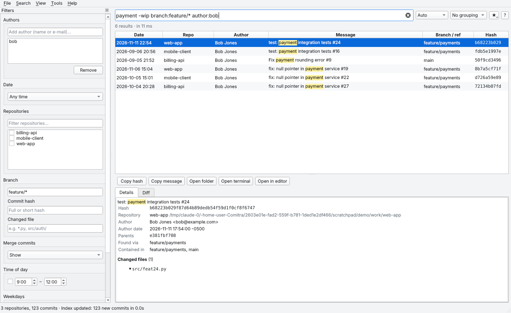
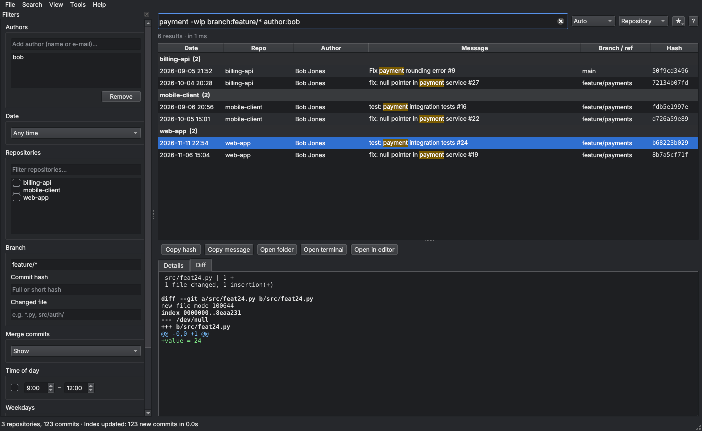

# Comitra

**Search commits across all your local git repositories, on every branch, from one place.**

🌐 **Website and downloads:** <https://oguzcanozdemir.github.io/Comitra/>

Comitra is a fully offline desktop app for Windows, macOS and Linux. It finds the git
repositories on your computer by itself, indexes their commits into a local SQLite
database and lets you search them in milliseconds. Your data never leaves your computer.



## Features

- **Automatic repository discovery**: searches your home folder (and other fixed drives
  on Windows) out of the box; add more folders if you like. Finds regular repos,
  submodules and bare repos. Linked worktrees are de-duplicated; system folders, hidden
  folders, app bundles and folders such as `node_modules` and `venv` are skipped.
- **Every branch**: local and remote branches, tags and detached HEAD.
- **Full-text search**: case- and accent-insensitive (`cafe` finds `Café`), with exact
  phrases, prefixes and exclusions.
- **Filters**: author (including co-authors), date ranges and presets, repository,
  branch (`feature/*`), hash, changed file, merge commits, time of day and weekday.
- **Search box and filter panel stay in sync**: a change in one shows up in the other.
- **Results**: newest / oldest / most relevant ordering, highlighted matches, grouping by
  repository, author or day, and smooth virtual scrolling even with millions of results.
- **Detail panel**: full message, both dates, co-authors, the branches that contain the
  commit, changed files and a colored diff.
- **Quick actions**: copy the hash; open the repository in your file manager, terminal or editor.
- **Incremental updates**: only changed repositories are rescanned. Old-dated commits that
  arrive with a fetch are still picked up. Commits lost to a force-push or rebase are
  flagged, not deleted.
- **Background updates**: on start-up, on a schedule, or when a repository changes.
- **Optional, safe `git fetch`**: never prompts for passwords, has a timeout, never prunes.
- Saved and recent searches, a statistics screen, CSV/JSON export.
- Light and dark themes, keyboard shortcuts.
- Installer and **portable** editions.
- A **command-line tool** for everything the GUI does.



## Installation

The only requirement is **git** (<https://git-scm.com>).
Ready-made packages are on the [Releases](../../releases) page:

| Platform | Installer | Portable |
| --- | --- | --- |
| Windows 10/11 (x64) | `Comitra-…-windows-x64-setup.exe` (no admin rights needed) | `Comitra-…-windows-x64-portable.zip` |
| macOS 11+ (Apple Silicon / Intel) | `Comitra-…-macos-arm64.dmg` / `…-x64.dmg` | `Comitra-…-macos-…-portable.zip` |
| Linux (x86_64) | `Comitra-…-linux-x86_64.AppImage` | `Comitra-…-linux-x86_64-portable.tar.gz` |

- **Windows:** run the installer. If SmartScreen warns you, choose *More info → Run anyway*
  (the package is not code-signed). For the portable edition, unzip it and run `Comitra.exe`.
- **macOS:** open the `.dmg` and drag Comitra to *Applications*. On first launch,
  right-click the app and choose *Open* (the package is not notarized by Apple). Move the
  portable edition out of *Downloads* before opening it. Allow access if macOS asks about
  folders such as Desktop or Documents.
- **Linux:** make the AppImage executable (`chmod +x Comitra-*.AppImage`) and run it.
  After extracting the portable archive you can run `./install.sh` to add Comitra to the
  application menu.

### Portable mode

Portable packages contain a `comitra-portable.txt` file next to the program. While it
exists, settings and the index are stored in a `comitra-data` folder next to the program,
so you can carry the whole folder on a USB stick. Delete the file to use the normal
per-user locations:

| | Settings | Database |
| --- | --- | --- |
| Windows | `%APPDATA%\Comitra` | `%LOCALAPPDATA%\Comitra` |
| macOS | `~/Library/Application Support/Comitra` | same |
| Linux | `~/.config/Comitra` | `~/.local/share/Comitra` |

The `--portable` option and the `COMITRA_HOME=/some/folder` environment variable do the same.

## Usage

1. Start Comitra. On first start it searches your home folder (and, on Windows, other
   fixed drives) for git repositories and indexes them. Progress is shown in the status bar.
2. Projects somewhere else, such as an external disk? Add that folder with
   **File → Add folder…** or in **Settings → Folders**. Automatic discovery can be
   turned off there as well.
3. Type in the search box or use the filter panel on the left.

### Query syntax

```
payment error                  all words (case- and accent-insensitive)
"payment error"                exact phrase
login*                         prefix
-wip  -"work in progress"      exclude
author:alice,bob@example.com   author or co-author name / e-mail contains
repo:billing                   repository name or path contains
branch:main branch:feature/*   reachable from matching branches (wildcards)
hash:a1b2c3d                   hash (typing a bare hash works too)
file:*.py file:src/auth/       changed file – needs the file index (Settings)
date:today|yesterday|7d|30d|month|year
date:2026-11-10   date:2026-10-01..2026-10-31   date:2026-10
after:2026-10-01 before:2026-11-01             after is inclusive, before is exclusive
hour:09-12  hour:22-06         time of day (in the author's time zone)
day:fri,sat  day:weekend       weekday
merge:hide|only                hide merge commits / only merge commits
unreachable:include|only       commits that are no longer on any branch
sort:newest|oldest|relevance   sort order
```

Example: `author:alice repo:billing branch:feature/* after:2026-10-01 before:2026-11-01 payment -wip`

Several values of the same filter are combined with **OR**; different filters with **AND**.

### Keyboard shortcuts

| Shortcut | Action |
| --- | --- |
| Ctrl/⌘ + K (or F, L) | Focus search |
| Esc | Clear search |
| ↓ | Move from the search box to the results |
| F5 / Shift + F5 | Update the index / update with fetch |
| Ctrl/⌘ + S | Save search |
| Ctrl/⌘ + E | Export results |
| Ctrl/⌘ + Shift + C | Copy hash |
| Ctrl/⌘ + Shift + O / T / E | Open in file manager / terminal / editor |
| Ctrl/⌘ + 0 / 1 / 2 / 3 | Group by: none / repository / author / day |
| Ctrl/⌘ + , | Settings |

### Command line

Installed and portable packages include a `comitra-cli` tool (with the AppImage use
`./Comitra.AppImage cli …`). From source, use `python -m comitra …`.

```bash
comitra-cli roots                      # folders that are scanned (home folder is automatic)
comitra-cli add /mnt/work              # add another folder to scan
comitra-cli auto off                   # turn automatic discovery off (or on)
comitra-cli update [--fetch] [--full]  # scan and index
comitra-cli search 'author:alice date:7d payment' --limit 20
comitra-cli search 'repo:billing' --format csv > results.csv
comitra-cli search 'merge:only' --group repo
comitra-cli repos                      # indexed repositories
comitra-cli stats                      # statistics
comitra-cli info                       # data location, git and SQLite versions
```

## Running from source

Requires Python 3.11 or newer.

```bash
git clone https://github.com/OguzcanOzdemir/Comitra.git
cd Comitra
python -m venv .venv
source .venv/bin/activate            # Windows: .venv\Scripts\activate
pip install -e ".[dev]"
python -m comitra                    # GUI
python -m pytest                     # tests
```

On Linux, Qt may need a few system libraries:
`sudo apt install libegl1 libxkbcommon-x11-0 libxcb-cursor0`.

## Building packages

```bash
pip install . pyinstaller pillow
python packaging/build.py
```

Output goes to `dist/release/`. Each platform's packages are built on that platform:

- **Windows:** PyInstaller + [Inno Setup 6](https://jrsoftware.org/isinfo.php) → `setup.exe`, portable `zip`
- **macOS:** PyInstaller → `.app`, `hdiutil` → `.dmg`, portable `zip`
- **Linux:** PyInstaller → portable `tar.gz`, `appimagetool` → `AppImage`

GitHub Actions does this automatically: every push runs the tests on all three operating
systems and builds the packages as artifacts (`.github/workflows/ci.yml`). Pushing a tag
such as `v1.2.3` attaches every package to a GitHub Release (`release.yml`).

## Project layout

```
comitra/
  core/          Qt-independent core (scanner, indexer, search, query language…)
  ui/            PySide6 user interface
  cli.py         command line
  config.py      settings, data folders, portable mode
packaging/       PyInstaller spec, Inno Setup, AppImage, build script
tests/           pytest tests (against real git repositories)
site/            GitHub Pages website (generated by tools/build_site.py)
docs/DESIGN.md   design decisions
TASKS.md         task list and roadmap
```

See [docs/DESIGN.md](docs/DESIGN.md) for the reasoning behind the design (branch
membership, text normalization, force-push handling, fetch safety and more).

## Privacy

Comitra makes no network requests. There is no telemetry and no automatic update check.
The only exception is the optional `git fetch` you can turn on in Settings, which only
talks to your own git servers. The index is stored only on your computer.

## License

MIT. The user interface uses Qt for Python (PySide6), licensed under the LGPLv3.
